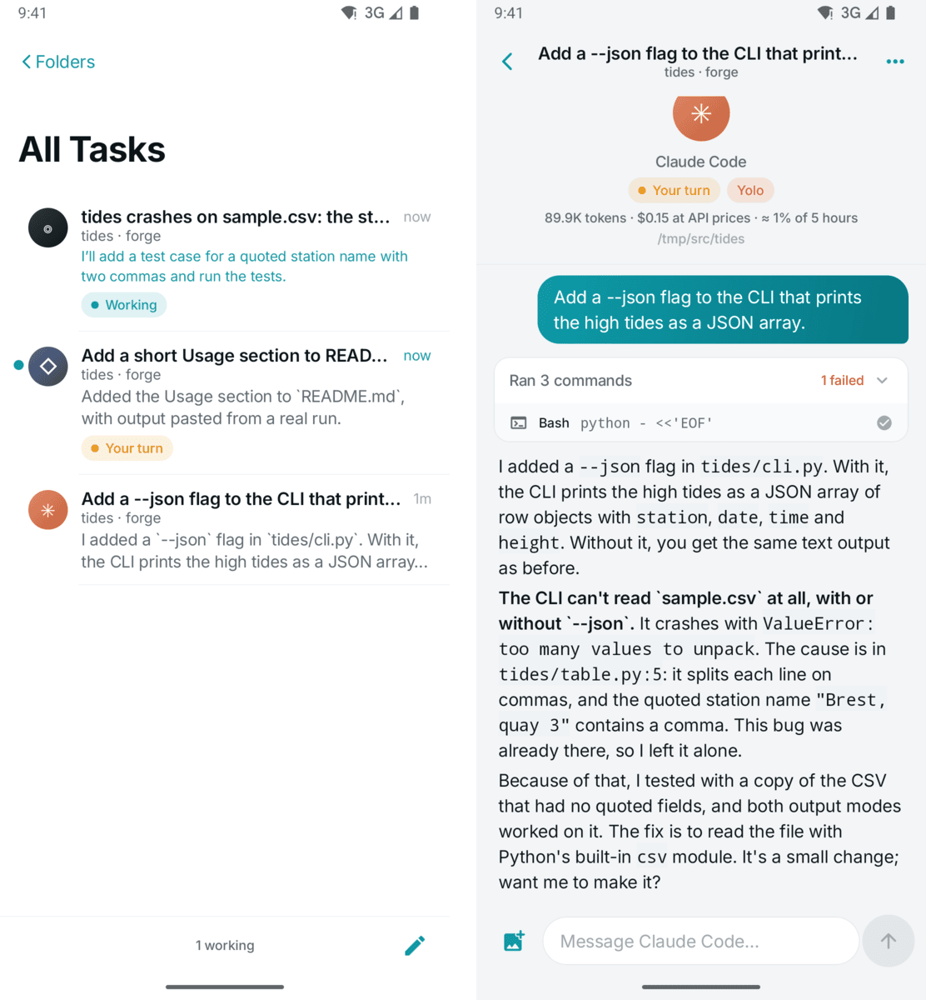
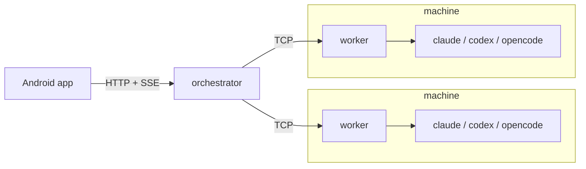

# dewy

Steer your coding agents from your phone. Claude Code, Codex, and opencode run on your own machines, and dewy puts their tasks in an inbox on your phone. You watch each agent work and reply to steer it.



**The backend is written in aki**, a systems language that compiles to native code through LLVM ([akiv4](https://github.com/aki-language/akiv4)). The app is Kotlin and Jetpack Compose.



From the phone you can also:

- attach photos to a message
- pick the model opencode uses
- take over a Claude Code session from a terminal
- see each agent's usage limits, and what every task used
- turn a machine off once its tasks finish

## Requirements

- Machines that run agents: Linux, with `claude`, `codex`, or `opencode` logged in.
- The backend: `akiko`, the aki compiler, and a C compiler. The binaries it builds need only glibc.
  - Linux aarch64: `curl -sSf https://github.com/aki-language/akiv4/releases/latest/download/install.sh | sh`
  - Linux x86-64 has no release yet. Build akiko with [Nix](https://nixos.org/download), then use it inside akiv4's `nix develop` shell, which provides LLVM:
    ```
    git clone https://github.com/aki-language/akiv4 && cd akiv4
    nix develop -c bash -c 'tools/seed_from_source.sh && tools/bootstrap.sh'
    ```
- The app: a JDK and the Android SDK, both in this repository's `nix develop` shell.

## Run it

```
cd orchestrator && akiko build
DEWY_TOKEN=$(openssl rand -hex 24) ./build/orchestrator --data ~/.local/share/dewy

cd worker && akiko build      # on each machine
DEWY_TOKEN=<same token> ./build/worker --orchestrator <host>:8788 --projects ~/Projects

cd apps/android && ./gradlew installDebug
```

The app asks for the orchestrator's address (port 8787) and the token. Workers connect out, so machines behind NAT need no open port. `akiko test` and `./gradlew testDebugUnitTest` run the tests.

## Before you rely on it

- The orchestrator speaks plain HTTP with one shared token. Keep it on a tailnet or behind a TLS proxy.
- Agents run without asking you. Yolo mode, per task or `worker --yolo`, also lifts their sandboxes. Anyone with the token can start one, or turn off a machine, so keep the token private.
- A machine that dewy turned off stays off until someone turns it on.

`docs/` has the [protocol](docs/protocol.md) and the [design decisions](docs/adr/).
